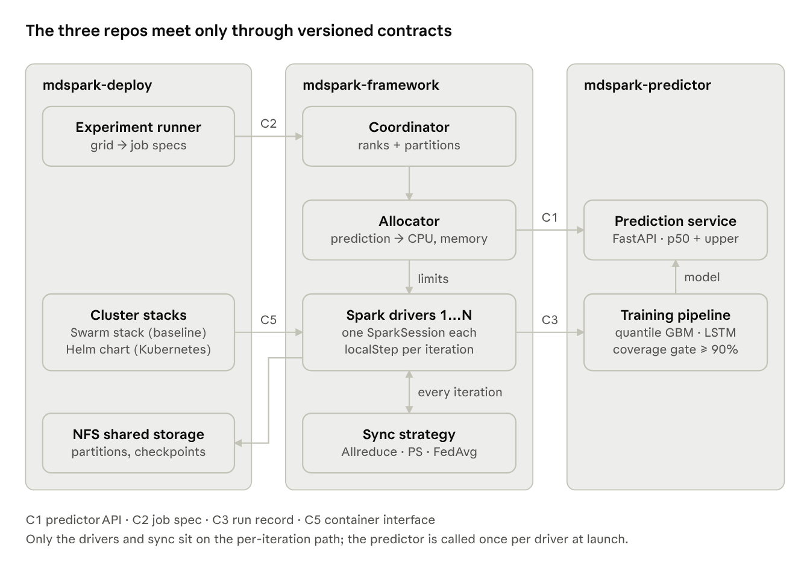

# mdspark-framework

JVM-native multi-driver execution framework for Apache Spark: a root coordinator, N independent Spark drivers, per-iteration cross-driver model synchronization, and workload-aware CPU and memory allocation.

> **Status: specification only.** Development starts after the Python prototype ([Multi-diver-spark-architecture-prototype](https://github.com/Ravindu56/Multi-diver-spark-architecture-prototype)) is finished and tagged. Until then this repo holds the base specification and repository setup. See [docs/specs/mdspark-base-spec.md](docs/specs/mdspark-base-spec.md).

## Where this repo fits

MDSpark is split across three repositories that meet only through versioned contracts (spec §3):

| Repository | Role |
| --- | --- |
| **mdspark-framework** (this repo) | Coordinator, driver runtime, sync strategies, allocator, CLI, contracts, Kubernetes operator |
| [mdspark-predictor](https://github.com/Ravindu56/mdspark-predictor) | Python service that predicts per-driver CPU and memory demand |
| [mdspark-deploy](https://github.com/Ravindu56/mdspark-deploy) | Docker/Swarm stacks, Kubernetes Helm chart, experiment runner |

This repo is also the **source of truth for every cross-repo contract** (`mdspark-api/contracts/`): the predictor API (C1), job specification (C2), run-record schema (C3), runtime metrics (C4) and container interface (C5).

## Planned modules

| Module | Responsibility |
| --- | --- |
| `mdspark-api` | Contracts, domain types and SPI traits (`IterativeWorkload`, `SyncStrategy`, `Transport`, `Allocator`, `PredictorClient`) |
| `mdspark-core` | Coordinator, driver lifecycle, partitioning, checkpoint/restore |
| `mdspark-sync` | Synchronous Allreduce (star, ring, tree), async parameter server, FedAvg; Open MPI, in-memory and gRPC transports |
| `mdspark-allocator` | Predicted per-driver CPU/memory (upper bound + 10%), static fallback |
| `mdspark-metrics` | Per-iteration timing, resource sampling, JSON Lines run records, Prometheus endpoint |
| `mdspark-cli` | Single entry point: `mdspark run \| bench \| validate \| inspect` |
| `mdspark-examples` | WordCount, K-Means, logistic regression |
| `mdspark-operator` | Kubernetes operator for `MultiDriverJob` (extension track) |

## Platform

| Component | Choice |
| --- | --- |
| Language | Scala 2.13 (Java for the operator) |
| Spark | 4.2.0 |
| JDK | 17 or 21, fixed by the Open MPI spike |
| Build | sbt, one multi-project build and one version |
| Cross-driver transport | Open MPI 5.0.x Java bindings (`mpirun`); gRPC as last-resort fallback |

The Open MPI Java bindings are not on Maven Central: `mpi.jar` comes from the Open MPI install in the shared base image (spec §4.7).

## Roadmap

| Milestone | Scope |
| --- | --- |
| M0 Bootstrap | Builds, CI, module skeletons, contracts v1 draft, ADRs, Open MPI spike |
| M1 Core on one host | Coordinator, drivers, synchronous Allreduce, parity with the prototype |
| M2 Containerized | Images and compose stack (with mdspark-deploy) |
| M3 Multi-host Swarm | Cross-host scaling on 2–3 physical hosts |
| M4 Prediction + allocation | Predictor-driven allocator (with mdspark-predictor) |
| M5 Full evaluation | Complete experiment grid for EC6070 |
| M6 Kubernetes extension | Operator, Volcano gang scheduling, Helm chart |

## Documentation

- [Base specification](docs/specs/mdspark-base-spec.md): architecture, contracts, module design, evaluation plan, milestones and the 16 settled decisions.
- `docs/adr/`: architecture decision records (to be added in M0, one per decision in spec §10).

## Contributing

`main` is protected. Use short-lived `feat/`, `fix/` or `exp/` branches, Conventional Commits, and get a review from the other team member before merging. A contract change goes in its own PR, followed by pin updates in the predictor and deploy repos.

## Project

EC6070 research project, *Resource Analysis and Optimization for Big Data Analytics in Cloud Environments*, Department of Computer Engineering, Faculty of Engineering, University of Jaffna.

- Students: Dayarathna D.D.R.N. (2022E033), Lawanya M.A.S. (2022E090)
- Supervisor: Dr. J. Jananie
- Architectural reference: Saleh et al., "MPJ-SPARK Integration-Based Technique to Enhance Big Data Analytics in High Performance Computing Environments," *IEEE Access*, 2025.

## License

[Apache License 2.0](LICENSE)
