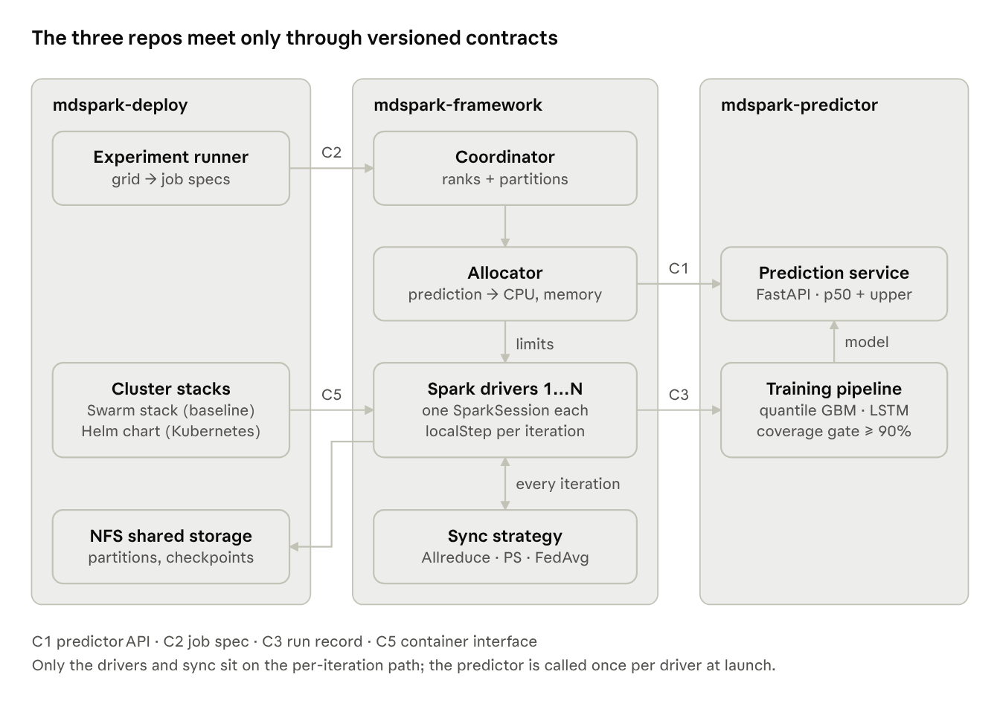

# MDSpark Base Specification — Framework, Predictor, Deploy

Version 1.0 · 15 Nov 2026 · EC6070, Department of Computer Engineering, University of Jaffna

> Status: base specification. Development of the three MDSpark repositories starts only after the Python prototype is finished and tagged (see §1, *Sequencing and prototype freeze*).

## 1. Purpose and scope

MDSpark is a JVM-native (Scala/Java) redesign of the multi-driver Spark prototype, split across three repositories, with the Python prototype frozen as the reference implementation. It keeps the architecture the prototype validated: a root coordinator, N independent Spark drivers, cross-driver model synchronization, and workload-aware CPU and memory allocation.

| Repository | Language | Owns |
| --- | --- | --- |
| [Ravindu56/mdspark-framework](https://github.com/Ravindu56/mdspark-framework) | Scala 2.13 (Java for the operator) | Coordinator, driver runtime, sync strategies, allocator, contracts, CLI, K8s operator |
| [Ravindu56/mdspark-predictor](https://github.com/Ravindu56/mdspark-predictor) | Python | Resource-demand model training and the prediction service |
| [Ravindu56/mdspark-deploy](https://github.com/Ravindu56/mdspark-deploy) | YAML, Helm, shell | Docker/Swarm stacks, Kubernetes manifests and Helm chart, experiment runner |
| [Multi-diver-spark-architecture-prototype](https://github.com/Ravindu56/Multi-diver-spark-architecture-prototype) | Python | In active development; frozen as the reference and baseline B0 when it ends |

**Goals**

- G1: JVM-native multi-driver execution, with per-iteration cross-driver synchronization for iterative ML (K-Means, logistic regression) and batch analytics (WordCount).
- G2: Workload-aware per-driver CPU and memory allocation, driven by a Python prediction service.
- G3: A Docker/Swarm deployment as the evaluated EC6070 baseline, and a Kubernetes-native deployment as the extension track.
- G4: Reproducible experiments that compare the redesign with the prototype and with the proposal's two baselines.
- G5: Validation across separate physical hosts, which the prototype's single-laptop testbed could not show.

**Non-goals**

- Improving ML model accuracy or designing new ML algorithms.
- Stream processing.
- HPC/SLURM deployment.
- Multi-tenant SaaS concerns (billing, tenant isolation, a public API).

**Claim boundary carried over from the prototype.** Prior results were obtained on three VMs hosted on one laptop. Eight-worker runs were unstable, with the cause unmeasured. The redesign must not cite those results as multi-host evidence.

**Sequencing and prototype freeze.** The prototype repo is still in active development, and MDSpark development starts only after that work ends. At that point the prototype is tagged at its final commit (proposed: `v1.0-prototype`), and that tag is cited for every prior result and used as baseline B0. Until then, the three MDSpark repos hold only this spec and repository setup. Findings from the remaining prototype work, such as the predictor and allocator issues, are folded into this spec before M0 starts.

## 2. System overview

A job flows from the experiment runner (deploy) to the coordinator (framework). The coordinator gets sizes from the predictor and starts N drivers, which synchronize every iteration. Run records then flow back to predictor training.



Each arrow that crosses a repo boundary is a versioned contract from §3. §4.2 gives the step-by-step lifecycle.

## 3. Cross-repo contracts and versioning

Every interface that crosses a repository boundary is written once, as a versioned file in `mdspark-framework/mdspark-api/contracts/`. The other repos pin a version of that file and test against it.

| Contract | Source of truth | Format | Producer | Consumers |
| --- | --- | --- | --- | --- |
| C1 Predictor API | `contracts/predictor/v1/openapi.yaml` | OpenAPI 3.1 | mdspark-predictor | mdspark-allocator (Scala client) |
| C2 Job specification | `contracts/job/v1/job.schema.json` | JSON Schema; also the K8s CRD | User / experiment runner | Coordinator, operator, deploy |
| C3 Experiment record | `contracts/metrics/v1/run-record.schema.json` | JSON Schema, JSON Lines files | Framework metrics | Predictor training, analysis |
| C4 Runtime metrics | `contracts/metrics/v1/prometheus.md` | Prometheus metric names and labels | Framework, predictor | Deploy (Grafana dashboards) |
| C5 Container interface | `contracts/runtime/v1/images.md` | Image names, env vars, ports, mounts | Framework, predictor | mdspark-deploy |
| C6 Sync wire protocol | `contracts/sync/v1/sync.proto` | Protobuf | Framework (internal) | Framework only |

**Versioning rules**

- Each repo uses SemVer and releases from Git tags (`vMAJOR.MINOR.PATCH`).
- Contracts are versioned by path (`v1`, `v2`), separately from the repo versions. A breaking change creates a new path; the old one stays supported for at least one framework minor release.
- A contract change goes in its own PR in mdspark-framework. The predictor and deploy repos then bump their pinned copy in a follow-up PR.
- `mdspark-deploy/COMPATIBILITY.md` lists every tested combination, for example framework 0.3.0 + predictor 0.2.1 + deploy 0.2.0. Experiment records store all three versions.

**Published artifacts**

| Artifact | Registry | Name |
| --- | --- | --- |
| Framework JARs | GitHub Packages (Maven) | `io.github.ravindu56:mdspark-*` |
| Framework image | GHCR | `ghcr.io/ravindu56/mdspark-driver`, `ghcr.io/ravindu56/mdspark-coordinator` |
| Operator image | GHCR | `ghcr.io/ravindu56/mdspark-operator` |
| Predictor image | GHCR | `ghcr.io/ravindu56/mdspark-predictor` |
| Helm chart | GHCR (OCI) | `oci://ghcr.io/ravindu56/charts/mdspark` |
| Model artifacts | GitHub Releases on mdspark-predictor (or MinIO) | `model-<family>-<yyyy.mm.n>.tar.gz` + model card |

## 4. mdspark-framework

One multi-module build with one version. It holds everything on the execution path, and nothing in it depends on Python.

```text
mdspark-framework/
├── mdspark-api/          contracts/, domain types, SPI traits (no Spark dependency)
├── mdspark-core/         coordinator, driver runtime, partitioning, checkpointing
├── mdspark-sync/         SyncStrategy implementations + Transport implementations
├── mdspark-allocator/    allocation policy, predictor client, fallback policy
├── mdspark-metrics/      timing breakdown, resource sampling, run-record writer, Prometheus
├── mdspark-cli/          single entry point: mdspark run | bench | validate | inspect
├── mdspark-examples/     WordCount, K-Means, LogisticRegression workloads
├── mdspark-operator/     Kubernetes operator for MultiDriverJob (extension track)
└── docs/adr/             architecture decision records
```

| Module | Responsibility | Depends on |
| --- | --- | --- |
| mdspark-api | Job spec, ModelState, WorkloadProfile, Prediction, ResourceSpec types; SPI traits; generated contract clients | — |
| mdspark-core | Coordinator, driver lifecycle, data partitioning by metadata, checkpoint/restore | api, sync, metrics |
| mdspark-sync | Synchronous Allreduce, async parameter server, FedAvg; Open MPI, in-memory and gRPC transports | api |
| mdspark-allocator | Turns predictions into per-driver CPU and memory; fallback to static sizing | api |
| mdspark-metrics | Per-iteration timing, CPU/memory sampling, JSON Lines run records, `/metrics` endpoint | api |
| mdspark-cli | Parses the job spec and launches the coordinator; replaces the prototype's many entry points (prototype #97) | core, allocator |
| mdspark-examples | Reference workloads implementing `IterativeWorkload` / `BatchWorkload` | api |
| mdspark-operator | Reconciles `MultiDriverJob` into gang-scheduled driver pods | api, allocator |

### 4.1 Core interfaces (SPI)

```scala
// mdspark-api
trait IterativeWorkload {
  def init(ctx: DriverContext): ModelState
  def localStep(ctx: DriverContext, data: DataFrame, global: ModelState): LocalUpdate
  def converged(prev: ModelState, next: ModelState, iter: Int): Boolean
}

trait SyncStrategy {
  def init(ctx: SyncContext): Unit
  def sync(local: LocalUpdate, iter: Int): ModelState   // returns the new global state
  def close(): Unit
}

trait Transport {
  def rank: Int; def size: Int
  def allreduce(buf: Array[Double], op: ReduceOp): Array[Double]
  def broadcast(buf: Array[Double], root: Int): Array[Double]
  def barrier(): Unit
}

trait PredictorClient {
  def predict(profile: WorkloadProfile): Either[PredictorError, Prediction]
}

trait Allocator {
  def allocate(job: JobSpec, preds: Map[DriverId, Option[Prediction]]): Map[DriverId, ResourceSpec]
}
```

`ModelState` is a flat `Array[Double]` plus shape metadata, so every strategy and transport works for both K-Means centroids and logistic regression weights.

### 4.2 Driver lifecycle

1. **Rendezvous.** The coordinator starts and the drivers register. Every driver gets a rank, the world size and its partition metadata.
2. **Allocation.** Before launch, the coordinator asks the predictor once per driver, applies the allocator and starts each driver with its ResourceSpec.
3. **Load.** Each driver creates its own SparkSession and reads its partition from shared storage. Load time is recorded separately from processing time.
4. **Iterate.** Each iteration runs `localStep`, then `sync`, then the convergence check. Every phase is timed.
5. **Checkpoint.** Every k iterations, global state is written to shared storage, so a restarted driver resumes from the latest checkpoint.
6. **Finalize.** Root aggregation runs, the run record is written and the drivers stop.

### 4.3 Synchronization strategies

| Strategy | Behaviour | Key parameter | Default |
| --- | --- | --- | --- |
| Synchronous Allreduce | Every driver waits at a barrier each iteration; identical global state | reduce op (mean / sum); topology star (default), ring or tree | Yes (primary) |
| Async parameter server | Drivers push updates and pull the latest state without a barrier | staleness bound s | No |
| FedAvg | Drivers run E local steps between averaging rounds | local steps E | No |

Transports: `MpiTransport` (Open MPI Java bindings over JNI) is the default for deployments (D6), and `InMemoryTransport` runs N drivers in one JVM for tests. `mpirun` starts every rank: the coordinator is rank 0 and the drivers are ranks 1…N. The Allreduce topology is set per job: star (gather and broadcast through the coordinator; the default), ring or tree (D8). Open MPI's native `allReduce` is kept as a measured comparison. A gRPC transport behind the same trait is the last-resort fallback.

### 4.4 Metrics emitted

- Per iteration: `compute_ms`, `sync_ms`, `barrier_wait_ms`, `serialize_ms`, `state_bytes`.
- Per run: `startup_ms`, `load_ms`, `total_ms`, iterations to converge, final objective (WCSS or loss).
- Sampled every second per driver: CPU cores used, RSS and JVM heap, against the allocated limits.
- The split between useful iteration time and startup overhead is part of the schema, not left to analysis scripts.

### 4.5 Job specification (example)

```yaml
apiVersion: mdspark.io/v1
kind: MultiDriverJob
metadata: { name: kmeans-1g-4d }
spec:
  workload: { class: io.mdspark.examples.KMeans, params: { k: 8, maxIter: 30, tol: 1e-4 } }
  data: { uri: file:///data/kmeans/1g.parquet, partitioning: by-file }
  drivers: 4
  sync: { strategy: allreduce, topology: star, checkpointEvery: 5 }
  allocation: { mode: predicted, fallback: { cpu: 2, memoryMb: 2048 } }
  experiment: { id: E2-kmeans-scaling, repeat: 3 }
```

### 4.6 Tests

- Unit: strategies and allocator against fixed inputs.
- Integration: N drivers in one JVM over `InMemoryTransport`, with Spark in local mode.
- Parity: the same dataset and seed as the prototype must give matching centroids or weights within tolerance (proposed: relative error below 1e-6 for synchronous Allreduce).
- Container: Testcontainers runs a coordinator and 2 drivers over Open MPI.

### 4.7 Platform baseline

| Component | Version | Note |
| --- | --- | --- |
| Scala | 2.13 | [Spark 4.2.0 is published for Scala 2.13](https://index.scala-lang.org/apache/spark/artifacts/spark-pipelines/4.2.0) |
| Apache Spark | 4.2.0 | [Released July 2026](https://spark.apache.org/releases/spark-release-4-2-0.html), the third 4.x release |
| JDK | 17 or 21 (open item) | Spark 4.x needs Java 17 or later; the Open MPI spike decides between the two |
| Build | sbt | `mpi.jar` comes from the Open MPI install in the base image, added as an unmanaged JAR |
| MPI library | Open MPI 5.0.x, built with `--enable-mpi-java` | [Java bindings are provisional](https://docs.open-mpi.org/en/main/features/java.html) and need shared libraries |
| Operator | Java | Java Operator SDK or fabric8 client |
| Licence | Apache-2.0 | Open MPI's BSD-style licence is compatible |

**Open MPI integration spike (before M1).** The Java bindings are maintained but provisional, and they pass Java arrays through JNI. Spend about one day proving the full stack:

- Base image: Open MPI 5.0.x built from source with `--enable-mpi-java`, JDK 17 and 21, and Spark 4.2.0.
- 4 containers started by `mpirun` from a hostfile. Each rank opens a SparkSession and runs an Allreduce of 1,000,000 doubles via star, ring and the native `allReduce`, checked against a local sum.
- Compare Java arrays with direct buffers (`MPI.newDoubleBuffer`), because arrays are copied through JNI.
- Pass: correct results on at least one JDK, which then fixes the JDK. Fail: adopt the gRPC fallback and record the reason in an ADR.

**Launching.** `mpirun` starts every rank over SSH, so the images run `sshd`, share a key and run ranks as a non-root user. On Swarm, a launcher service builds the hostfile from Swarm DNS names. On Kubernetes, the operator creates a Volcano Job with the `mpi` plugin, which sets up SSH and per-task host files. The Kubeflow MPI Operator would also work, because it uses standard `mpirun`.

## 5. mdspark-predictor

A Python service that returns per-driver CPU and memory demand as an interval: a median plus an upper bound. It is called once per driver at job launch, never per iteration, so it stays off the execution path.

```text
mdspark-predictor/
├── contract/        pinned copy of predictor/v1/openapi.yaml + run-record schema
├── training/
│   ├── ingest.py    reads C3 run records (JSON Lines) into a feature table
│   ├── features.py  WorkloadProfile → feature vector
│   ├── models/      quantile regression / GBM (primary), optional LSTM comparison
│   └── evaluate.py  MAE, interval coverage, out-of-range behaviour
├── service/         FastAPI app, model loader, /metrics
├── models/          model cards only (weights live in Releases / MinIO)
├── tests/           contract tests, coverage regression tests
└── Dockerfile
```

### 5.1 Service API (C1, v1)

| Method | Path | Purpose |
| --- | --- | --- |
| POST | `/v1/predict` | Predict demand for one driver's workload profile |
| POST | `/v1/predict/batch` | Predict for all drivers of one job in one call |
| GET | `/v1/models/active` | Active model version and its model card |
| GET | `/healthz`, `/readyz` | Liveness; readiness (model loaded) |
| GET | `/metrics` | Prometheus metrics |

Request and response:

```json
// POST /v1/predict
{ "algorithm": "kmeans", "dataset_bytes": 1073741824, "rows": 12000000,
  "features": 20, "iterations": 30, "k": 8, "drivers": 4,
  "sync_strategy": "allreduce" }

// 200 OK
{ "model_version": "gbm-q-2026.11.1",
  "cpu_cores": { "p50": 1.6, "upper": 2.4, "quantile": 0.90 },
  "memory_mb": { "p50": 1800, "upper": 2600, "quantile": 0.90 },
  "out_of_range": false, "out_of_range_features": [] }
```

### 5.2 Model requirements

- Each prediction gives a median and an upper quantile (p90, D13) for CPU p95 and peak memory.
- `out_of_range` is true when any input lies outside the training feature ranges recorded in the model card. The allocator must not trust an extrapolated value silently.
- Acceptance gate for a new active model: upper-bound coverage of at least 90% on held-out runs, for each algorithm, for both CPU and memory. The prototype predictor reached 75% for K-Means CPU p95.
- Models are trained only on runs in which Docker or Kubernetes limits were actually enforced. The prototype's data collection did not enforce memory caps.

### 5.3 Model card (stored with every model)

Version, model family, training-data hash and run count, feature ranges, per-algorithm MAE and coverage, the framework version the data came from, and the training date.

### 5.4 Non-functional targets

- p99 latency below 100 ms for a batch of 8 drivers on lab hardware.
- Stateless and horizontally scalable; the model is loaded at start.
- Failure is never fatal to a job: the framework applies a 2 s timeout and falls back to static allocation (§4).

Stack: Python 3.11+, FastAPI and Pydantic, scikit-learn (and LightGBM for quantile GBM), PyTorch only if the optional LSTM comparison is built, pytest, ruff and mypy.

## 6. mdspark-deploy

This repo turns published images and charts into running clusters, and it runs the experiments. It has two targets: Docker/Swarm, the evaluated EC6070 baseline, and Kubernetes, the extension track. It contains no framework source code.

```text
mdspark-deploy/
├── docker/
│   ├── compose/         single-host dev stack (coordinator, N drivers, predictor, NFS, Prometheus)
│   └── swarm/           multi-node stack files, node labels, NFS volume definition
├── k8s/
│   ├── cluster/         k3s install notes for 2–3 lab servers
│   ├── crds/            MultiDriverJob CRD (generated from C2)
│   └── charts/mdspark/  Helm chart: operator, predictor, RBAC, storage, dashboards
├── observability/       Prometheus scrape config, Grafana dashboards (C4)
├── experiments/
│   ├── matrices/        experiment grids as YAML (E1…En)
│   ├── run.sh           expands a matrix into job specs and submits them
│   └── results/         run records (git-ignored; archived per release)
├── datasets/            generators and checksums for synthetic datasets
└── COMPATIBILITY.md     tested framework × predictor × deploy versions
```

### 6.1 Target comparison

| Concern | Docker / Swarm (baseline) | Kubernetes (extension) |
| --- | --- | --- |
| Job submission | `mdspark run job.yaml` against the stack | `kubectl apply` of a `MultiDriverJob`, reconciled by the operator |
| Coordinator | Its own service | Operator controller plus a coordinator pod per job |
| Drivers | One service replica per rank, placed by node labels | One pod per driver; Spark executors as pods (client mode) |
| Discovery | Swarm DNS; launcher writes the `mpirun` hostfile | Volcano svc plugin: headless Service and per-task host files |
| Gang start | The coordinator waits for N registrations, with a timeout | Gang scheduler (PodGroup with minMember = N) |
| Shared storage | NFS volume (default), or MinIO via `s3a://` | ReadWriteMany PVC via an NFS provisioner, or MinIO via `s3a://` |
| Resource enforcement | `deploy.resources.limits` per replica | Pod `requests` and `limits` set by the allocator |
| Predictor | Service | Deployment + Service, readiness probe |
| Metrics | Prometheus + Grafana containers | kube-prometheus-stack |

### 6.2 Requirements for valid experiments

- At least two physical hosts for every scaling result. Co-located VMs are reported only as development runs.
- Limits are enforced and verified: each run record stores the limits read back from the container runtime, not just the requested values.
- Clock sync (chrony) on all hosts, so cross-host timing is comparable.
- Every dataset has a fixed generator seed and a recorded checksum.
- A run is valid only when its record carries the framework, predictor and deploy versions.

### 6.3 CI for this repo

hadolint for any Dockerfiles, `docker compose config` validation, `helm lint` and `helm template` piped into kubeconform, and a smoke job that starts the compose stack and runs a 2-driver WordCount.

## 7. Engineering conventions

The same rules apply in all three repos, so either team member can work in any of them.

- **Branching:** `main` is protected and always releasable. Use short-lived `feat/`, `fix/` and `exp/` branches, and squash-merge them.
- **Reviews:** every PR is approved by the other team member. A contract change also needs a linked follow-up issue in each consuming repo.
- **Commits:** Conventional Commits (`feat(sync): add FedAvg strategy`), so changelogs can be generated per release.
- **Planning:** one GitHub Project board spanning all three repos, using labels `area/*`, `phase/*` and `objective/1a–2d`.
- **Decisions:** ADRs in `mdspark-framework/docs/adr/NNNN-title.md`. Each row of §10 becomes one ADR.
- **CI (GitHub Actions):**
  - framework: compile, scalafmt check, unit and integration tests, publish JARs and images on tag;
  - predictor: ruff, mypy, pytest, contract test against the pinned OpenAPI file, image on tag;
  - deploy: §6.3.
- **Docs in each repo:** README (quick start in under 10 commands), `ARCHITECTURE.md`, `CONTRIBUTING.md` and `CHANGELOG.md`.

## 8. Evaluation mapping

The redesign is evaluated against four baselines on the proposal's metrics, and every experiment maps to one secondary objective.

| Configuration | Drivers | Sync | Allocation | Purpose |
| --- | --- | --- | --- | --- |
| B0 Prototype (PySpark, frozen tag) | N | Allreduce | Static | Parity: isolates the effect of the language and Spark-version change |
| B1 Single-driver Spark | 1 | — | Static | Proposal baseline (i) |
| B2 Multi-driver, no sync, no prediction | N | None (independent) | Static | Proposal baseline (ii) |
| F Full MDSpark | N | Allreduce / PS / FedAvg | Predicted | Framework under test |

| Metric | Definition | Source field (C3) |
| --- | --- | --- |
| Execution time | Coordinator start to final aggregation | `total_ms` |
| Load vs processing time | Data load time vs iteration time | `load_ms`, sum of `compute_ms` + `sync_ms` |
| Synchronization overhead | Share of iteration time spent in sync and waiting | (`sync_ms` + `barrier_wait_ms`) / iteration time |
| Convergence rate | Iterations, and time, to reach tolerance | `iterations`, objective per iteration |
| CPU utilization | Mean and p95 cores used / cores allocated | sampled series |
| Memory utilization | Peak RSS / memory limit | sampled series |
| Throughput | Input bytes / processing time | `input_bytes`, timings |
| Allocation quality | Over-allocation, and under-allocation events (throttling, OOM) | limits vs usage |

| Objective | Repo(s) | Evidence |
| --- | --- | --- |
| 1a Cloud adaptation | deploy | Swarm runs on at least 2 physical hosts with NFS |
| 1b Cross-driver sync | framework (sync) | Parity tests and the sync-overhead metric |
| 1c Workload coverage | framework (examples) | WordCount, K-Means and LogReg on B0–F |
| 2a Profiling dataset | framework (metrics) + deploy | Run records with enforced limits |
| 2b Prediction model | predictor | Coverage of at least 90%, MAE, out-of-range behaviour |
| 2c Allocation strategy | framework (allocator) | F vs B2 on utilization and time |
| 2d Comparative evaluation | deploy (experiments) | Full grid, B0–F |

Proposed experiment grid: drivers {1, 2, 4, 8} × data size {100 MB, 1 GB, 5 GB} × workload {WordCount, K-Means, LogReg} × sync {Allreduce, PS, FedAvg} for the ML workloads, 3 repetitions each, reporting the median and range. Eight drivers stay in the grid only once the instability seen in the prototype is explained.

## 9. Milestones

There are seven milestones, M0–M6. M0–M5 make up the EC6070 deliverable, and M6 is the Kubernetes extension. Each one ends at a gate that must pass before the next starts. M0 starts only after prototype development ends and the prototype is tagged. No dates are set yet; add them at that point.

1. **M0 Bootstrap** (all repos): builds, CI, empty module skeletons, contracts C1–C5 at draft v1, ADRs for D1–D16, Open MPI spike (§4.7), prototype tagged.
   - Gate: CI green in all three repos; contracts reviewed by both members; the Open MPI spike passes, or the gRPC fallback is adopted.
2. **M1 Core on one host** (framework): coordinator, driver lifecycle, synchronous Allreduce over `InMemoryTransport` and `MpiTransport`, and the three example workloads.
   - Gate: parity with B0 on K-Means and LogReg (same seed, within tolerance).
3. **M2 Containerized** (framework + deploy): driver, coordinator and predictor-stub images; compose stack with NFS; run records written to C3.
   - Gate: 4-driver K-Means and LogReg pass on the compose stack; the record validates against its schema.
4. **M3 Multi-host Swarm** (deploy): 2–3 physical hosts, enforced limits, the scaling grid for B1, B2 and F (static allocation), and PS and FedAvg added.
   - Gate: a cross-host scaling result exists; the 8-driver behaviour is explained or 8 drivers are dropped with a stated reason.
5. **M4 Prediction + allocation** (predictor + framework): retrain on the M3 records, the predictor service, the allocator with fallback.
   - Gate: upper-bound coverage of at least 90% per algorithm; F with predicted allocation runs end to end.
6. **M5 Full evaluation** (deploy): the complete grid B0–F, analysis, thesis figures.
   - Gate: every metric in §8 is reported with its run-record provenance.
7. **M6 Kubernetes extension** (framework operator + deploy chart): MultiDriverJob CRD, operator, gang scheduling and the Helm chart on k3s.
   - Gate: the same K-Means job runs on Swarm and on k3s with matching results.

## 10. Decisions

All 16 decisions were settled on 15 Nov 2026; record each one as an ADR in `mdspark-framework/docs/adr/`. Three follow-up items came out of them:

- [ ] Open MPI integration spike before M1: JDK 17/21, Spark 4.2.0 and `mpirun` across containers (§4.7).
- [ ] Choose JDK 17 or 21 for all images, based on the spike result.
- [ ] Set the B0 parity tolerance after the first parity run, because B0 also differs in Spark version if the prototype used an older Spark.

| # | Decision | Chosen | Effect on this spec |
| --- | --- | --- | --- |
| D1 | Framework repo name | Renamed to `mdspark-framework` | Links updated in §1 |
| D2 | Scope | Docker/Swarm is evaluated; Kubernetes is the extension | M6 sits outside the EC6070 deliverable |
| D3 | Language | Scala 2.13 for core and sync; Java for the operator | §4.7 |
| D4 | Spark version | 4.2.0 | B0 comparison covers both the language and the Spark version (§8) |
| D5 | Build tool | sbt | §4.7 |
| D6 | Cross-driver transport | Open MPI Java bindings (revised from MPJ Express on 15 Nov) | `MpiTransport` is the default; Open MPI spike before M1; gRPC as last-resort fallback |
| D7 | Coordinator placement | Separate process | Coordinator is MPI rank 0, started by the same `mpirun` |
| D8 | Allreduce topology | Configurable: star (default), ring, tree | `sync.topology` in the job spec |
| D9 | Parameter-server host | Coordinator | No extra PS process |
| D10 | Shared storage | Both NFS and MinIO | Data URIs `file://` and `s3a://` (§6.1) |
| D11 | Experiments location | `mdspark-deploy/experiments` | §6 |
| D12 | Primary predictor model | Quantile GBM / regression | An LSTM is optional, as a comparison only |
| D13 | Upper-bound quantile | p90 | Matches the 90% coverage gate |
| D14 | Allocator policy | Upper bound + 10% headroom; static fallback when `out_of_range` is true | mdspark-allocator |
| D15 | Gang scheduler | Volcano (PodGroup minMember); Volcano Job also launches `mpirun` | M6 |
| D16 | Licence | Apache-2.0 | LICENSE file in all three repos |

## References

- Saleh et al., "MPJ-SPARK Integration-Based Technique to Enhance Big Data Analytics in High Performance Computing Environments," *IEEE Access*, 2025, doi: 10.1109/ACCESS.2025.3584744. (State-of-the-art architectural reference.)
- [Apache Spark 4.2.0 release notes](https://spark.apache.org/releases/spark-release-4-2-0.html)
- [Open MPI Java bindings](https://docs.open-mpi.org/en/main/features/java.html)
- [Volcano MPI plugin](https://volcano.sh/en/docs/user-guide/how_to_use_mpi_plugin)
